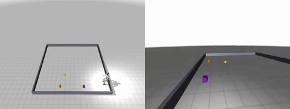
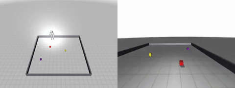
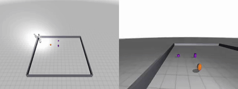

# G1Nav: Humanoid Locomotion RL with Hierarchical Target Navigation (Unitree G1, MuJoCo / MJX)

A PPO walking policy trained from scratch, driven by a hierarchical target-navigation layer:
a slow target-selection stage and a fast learned locomotion policy. A simulated Unitree G1 humanoid receives an English instruction such as
*"go to the red cube"*, a target is selected once, a Navigator turns the target position into
a velocity command, and a PPO policy trained from scratch outputs **29 lower-body PD joint
targets at 50 Hz** until the robot stops next to the object. Only the locomotion policy is
learned. **In the recorded demos the target is chosen by keyword matching against the
simulator's object labels and its position is read from the simulator (ground truth); the
GR00T N1.6 Eagle vision-language encoder runs on the ego frame, but its output is only
logged and does not affect the target.** The question this repository answers is therefore
the control half: can one velocity-conditioned walking policy, trained once with RL, be
driven by a simple Navigator to reach instructed targets in closed loop, physics only?

[](.github/workflows/ci.yml)
[](LICENSE)

Part of **[physical-ai-robot-learning](https://github.com/physical-ai-robot-learning)** — Physical AI / robot learning projects.

**Engineering report:** [`report/report.md`](report/report.md) ([PDF](report/report.pdf)) ·
**Results:** [`results/`](results/README.md) ·
**Claims check:** `python -m analysis.verify_claims` ([audit](docs/claims.md)) ·
**Third-party licences:** [`docs/third_party.md`](docs/third_party.md) · **Provenance:** [`docs/provenance.md`](docs/provenance.md) · status: finished prototype, 2026-11-01



*"go to the orange cylinder": third-person view (left) and ego camera (right), 2 s standing, walking, 2 s standing.*

## Result and status

**What works, measured how**

- **Walking from scratch.** The policy was trained for 154.8 M environment steps (77 min wall-clock,
  including compilation). In a CPU re-evaluation of all 16 saved checkpoints, the first one that walks
  without falling is at 41.3 M steps; the final policy moves at 0.52 m/s for a 0.6 m/s command
  (87 %) with a minimum torso height of 0.74 m over 5 s.
- **Closed-loop reaching.** In all 3 demo scenes the robot reaches the instructed object
  (Navigator stop radius 0.55 m) and stays upright: final distances 0.39 / 0.41 / 0.54 m,
  torso height 0.75–0.76 m. A CPU re-run of the three episodes reproduces these numbers.
- **What made it work.** Domain randomisation during training; evaluating in the raw
  environment, because the training wrapper's auto-reset made a falling policy look like it was
  stepping in place; and two deployment bugs: missing observation normalisation, and a gravity
  term computed in the wrong frame, which only showed when the robot turned
  ([engineering log](report/report.md#5-what-went-wrong-and-the-fixes-engineering-log)).

**What this repository does not show**

- **No learned or visual grounding.** Target selection is a keyword rule over simulator object
  labels, and the target position is simulator ground truth. The GR00T N1.6 Eagle embedding is
  computed and logged but never used. The colour/shape + ego-depth localisation code
  (`archive/color_detect.py`, `Navigator.lockGoalFromEgo`) is not used in the demos and was not
  evaluated.
- **No vision in the control loop.** The walking policy observes proprioception and the
  velocity command only. This is not an end-to-end vision-language-action model.
- **No success rate.** Three seeded scenes, one run each, static objects, flat terrain, and each
  instruction names a unique colour + shape. Seed 2 stops at 0.54 m against a 0.55 m radius.
- **No new locomotion method.** The policy follows the MuJoCo Playground G1 Joystick recipe and
  reward; the work here is the coupling and the debugging.
- **No hardware.** Simulation only; no sim-to-real transfer was attempted.
- **No original training logs.** Per-step training console logs and the GPU runs' closed-loop
  logs are not included; the walking and closed-loop numbers are re-measured on CPU from the
  committed checkpoints (`results/`).

## Repository map

| path | what | read this if… |
|---|---|---|
| [`src/g1nav/envs/`](src/g1nav/envs/README.md) | seeded arena scenes, instruction templates | you want to know what a scene / instruction is |
| [`src/g1nav/navigation/`](src/g1nav/navigation/README.md) | keyword target selection, Navigator, closed loop, demo re-run | you want the control loop and the deployment fixes |
| [`src/g1nav/locomotion/`](src/g1nav/locomotion/README.md) | PPO training of the walking policy, raw-environment evaluation | you want how the policy was trained and measured |
| [`src/g1nav/apps/`](src/g1nav/apps/README.md) | Streamlit dashboards (results replay, interactive runs, training monitor) | you want to look at runs without reading code |
| [`results/`](results/README.md) | checkpoints + training metrics (`checkpoints/`), CPU re-measurements | you want the files behind the numbers |
| [`media/`](media/README.md) | the three demo episodes (mp4, gif, start ego frame, cognition JSON) | you want to watch the result |
| [`analysis/`](analysis/README.md) | evidence readers and the claims check (CI) | you want to check a number |
| [`report/`](report/report.md) | engineering report (Markdown + PDF) | you want the full story, incl. what went wrong |
| [`docs/`](docs/) | install guide, claims audit, data note, provenance, third-party licences, refactor log | you want details |
| [`scripts/`](scripts/README.md) | install / dashboard launchers, GPU-machine (`pod/`) set-up and runners | you want to run things on a GPU machine |
| [`configs/envs/`](configs/envs/README.md) | pinned requirement files of the environments that produced the results | you want exact versions |
| [`tests/`](tests/) | characterization goldens, unit tests, opt-in simulation re-run | you want to know what is checked |
| [`assets/`](assets/) | vendored Menagerie Unitree G1 model, example generated scene | — |
| [`archive/`](archive/README.md) | unused code kept verbatim (BC teacher planner, colour detector) | you want superseded designs |

**Start reading here:** [`src/g1nav/navigation/navigate.py`](src/g1nav/navigation/navigate.py) (the closed loop and
the observation it must reproduce), [`src/g1nav/navigation/action_module.py`](src/g1nav/navigation/action_module.py)
(the Navigator), [`src/g1nav/locomotion/train_walk.py`](src/g1nav/locomotion/train_walk.py) (PPO training).

## Pipeline

| stage | what happens | learned? | module |
|---|---|:---:|---|
| 1 · scene | a seeded arena with three coloured objects and the G1 at a seeded spawn pose | no | `g1nav.envs.scene_gen` |
| 2 · target selection | the object label whose words overlap most with the instruction; position read from the generated scene. The GR00T N1.6 Eagle encoder embeds the start ego frame (logged only) | no | `g1nav.navigation.grounding`, `.cortex_eagle` |
| 3 · Navigator | turn-then-go controller: target world position + odometry → velocity command `(vx, vy, wz)` every 20 ms; stops within 0.55 m | no | `g1nav.navigation.action_module` |
| 4 · locomotion | PPO policy on MuJoCo Playground's `G1JoystickFlatTerrain` (MJX): 103-D proprioceptive observation + command → 29-D PD joint targets | yes, RL from scratch | `g1nav.locomotion.train_walk` |
| 5 · closed loop | MuJoCo physics at 500 Hz (10 substeps per control step), ego and third-person video | — | `g1nav.navigation.navigate` |

```bash
# 1. seeded scene (writes assets/scene_seed0.xml)
python -m g1nav.envs.scene_gen --seed 0

# 2-4. train the walking policy (GPU; default Playground reward scales)
python -m g1nav.locomotion.train_walk --timesteps 500000000 --num_envs 8192 \
    --termination -100 --track_lin 1.0 --stand_still -1.0 --num_evals 50 \
    --out results/checkpoints/walk_t4

#    evaluate every checkpoint in the raw environment (command vx = 0.6 m/s)
G1NAV_OUT_DIR=results/walk_sweep_cpu python -m g1nav.locomotion.walk_eval \
    --sweep results/checkpoints 'walk_t4_step*.pkl'

# 5. one closed-loop episode: scene -> keyword target -> Navigator -> policy -> physics -> video
python -m g1nav.navigation.pipeline --seed 0 --instruction "go to the orange cylinder"

#    re-measure the three demo episodes (CPU is enough)
python -m g1nav.navigation.rerun_demo_episodes --cpu --outdir results/demo_rerun_cpu
```

Conventions: the observation and action layouts are those of Playground's G1 Joystick
environment (103-D state, 216-D privileged state, 29 actions,
`motor_target = default_pose + 0.5 · action`); control at 50 Hz with physics at 500 Hz; the
velocity command is in the robot's heading frame.

## Install and test

```bash
git clone https://github.com/physical-ai-robot-learning/g1-target-walking.git
cd g1-target-walking
python -m pip install -e ".[test]"          # numpy + pytest + Pillow: enough for the checks
python -m analysis.verify_claims            # prints "70 claims checked, 0 failed."
python -m pytest -q tests                   # no GPU, no MuJoCo
```

Full stack: `bash scripts/install.sh` (NVIDIA GPU → pinned simulation/training stack, otherwise dashboards only),
then `source .venv/bin/activate && bash scripts/run_dashboard.sh`. The simulation stack is pinned to jax 0.5.3,
brax 0.14.2, flax 0.10.6, mujoco / mujoco-mjx 3.4.0 and playground 0.1.0 (`pip install -e ".[sim]"`;
[`configs/envs/`](configs/envs/README.md)). The GR00T N1.6 Eagle encoder is an **optional, logging-only** dependency kept in
[`configs/envs/requirements-eagle.txt`](configs/envs/requirements-eagle.txt) (old `transformers` pin for compatibility); it is not needed for
training, navigation or any reported result. Remote-GPU mode, the Eagle set-up and the CPU set-up used for the
re-measurements are described in [docs/install.md](docs/install.md).

**What runs where.** The checks and tests run anywhere. The closed-loop demo episodes and the checkpoint sweep run on
a CPU with the simulation extra (`G1NAV_SIM_TESTS=1 python -m pytest -q tests/test_sim_rerun.py` re-runs both, about
2 minutes). Full-scale PPO training needs an NVIDIA GPU; the Eagle encoder needs torch and a CUDA GPU; the original
GPU runs' logs are not reproducible from the repository.

## Results

`analysis/verify_claims.py` recomputes every number in this README, in
[`report/report.md`](report/report.md) and in [`media/README.md`](media/README.md) from files in
the repository (checkpoint pickles read without JAX, metrics JSONL, rollout JSON, cognition
JSON, MP4/GIF frame counts, the CPU re-measurements) and exits non-zero on any mismatch.

**Walking policy** (`results/checkpoints/`, `results/walk_sweep_cpu/walk_sweep.json`):

| | value | source |
|---|---|---|
| training steps (final checkpoint) | 154,828,800 | `step` field of `results/checkpoints/walk_t4_latest.pkl` |
| training time / final evaluation reward | 77.1 min / 9.29 | `results/checkpoints/walk_t4_metrics.jsonl` |
| first checkpoint that walks (raw env) | 41.3 M steps (0.32 m/s, min torso 0.73 m) | `results/walk_sweep_cpu/walk_sweep.json` |
| final policy, 5 s re-evaluation | 0.52 m/s for a 0.6 m/s command, 2.59 m, min torso 0.74 m | `results/walk_sweep_cpu/walk_sweep.json` |
| final policy, 4 s training-time rollout | 0.519 m/s, 2.07 m, min torso 0.745 m | `results/checkpoints/walk_t4_rollout.json` |
| highest forward velocity in the sweep | 0.58 m/s at 144.5 M steps | `results/walk_sweep_cpu/walk_sweep.json` |

**Closed-loop demo episodes** (`media/`, `results/demo_rerun_cpu/episodes.json`):

| instruction | chosen target | reached | final distance | torso height | frames |
|---|---|:---:|---:|---:|---:|
| "go to the orange cylinder" | orange cylinder | yes | 0.39 m | 0.75 m | 630 |
| "go to the red cube" | red cube | yes | 0.41 m | 0.76 m | 387 |
| "go to the purple cylinder" | purple cylinder | yes | 0.54 m | 0.75 m | 668 |

**"go to the red cube"**


**"go to the purple cylinder"**


Each episode also has its MP4 (50 fps), the start ego frame and the cognition JSON in
[`media/`](media/README.md). The cognition JSON stores the keyword-selected label under the
historical key `vlm_target` and the Eagle embedding size (286 tokens × 2048-d); its stage-3 text
describes a CV + depth localisation step that was not used (see `media/README.md`).

## Current vs superseded

| current | superseded (kept) |
|---|---|
| keyword target selection with a ground-truth position (`grounding.py`, `navigate.py`) | the intended frozen vision-language grounding and CV + ego-depth localisation (`cortex_eagle.py` embedding, `archive/color_detect.py`, `--use_vlm` flag declared but not implemented) |
| Navigator driving a velocity-conditioned PPO policy (`action_module.py`) | behaviour-cloning plan with a privileged teacher planner (`archive/planner.py`) |
| default Playground reward scales, raw-env evaluation (`walk_eval.py`) | edited reward scales (`train_walk.py` argument defaults `--termination -3 --track_lin 2.0 --stand_still -3.0`); the softened termination penalty produced the marching-in-place policy described in the report |

Earlier versions of this README and of the report presented the Eagle encoder as the grounding
stage; the repository history before 2026-09-27 reflects that wording. The code moved from `code/` to the
`src/g1nav` package in 2026-11 without behaviour change ([refactor log](docs/refactor_2026-11.md)).

## Design intuition (optional)

The split mirrors a common pattern in motor control: a slow, deliberate decision about *what*
and *where*, and a fast reactive controller for balance and stepping. Here the slow part runs
once per episode for a static scene and the fast part every 20 ms. This analogy motivated the
structure; nothing in this repository tests it.

## Attribution

- **Robot model:** `assets/mujoco_menagerie/unitree_g1/` is vendored from
  [MuJoCo Menagerie](https://github.com/google-deepmind/mujoco_menagerie) (Google DeepMind);
  the Unitree G1 model files are Copyright (c) 2016-2023 Unitree Robotics, BSD-3-Clause.
- **Environment and recipe:** the walking environment, reward and PPO hyperparameters come
  from [MuJoCo Playground](https://github.com/google-deepmind/mujoco_playground); training
  uses [Brax](https://github.com/google/brax) PPO and MuJoCo MJX.
- **Eagle encoder:** the vision-language backbone of
  [NVIDIA Isaac GR00T N1.6](https://github.com/NVIDIA/Isaac-GR00T); not redistributed here,
  obtained separately under NVIDIA's terms.

Details and licences: [`docs/third_party.md`](docs/third_party.md).

## License and citation

Original code, documentation, results and media in this repository are licensed under the
**PolyForm Noncommercial License 1.0.0** ([LICENSE](LICENSE)): free for research, teaching,
personal and other noncommercial use; commercial use requires a separate written agreement with
the author. Third-party parts keep their own licences (`assets/mujoco_menagerie/unitree_g1/`: BSD-3-Clause,
Unitree Robotics; see
[`docs/third_party.md`](docs/third_party.md)).

Citation: see [`CITATION.cff`](CITATION.cff).

```bibtex
@software{lee_g1nav_2026,
  author = {Lee, Jeong Hwan},
  title  = {G1Nav: Humanoid Locomotion RL with Hierarchical Target Navigation (Unitree G1, MuJoCo/MJX)},
  year   = {2026},
  url    = {https://github.com/physical-ai-robot-learning/g1-target-walking}
}
```
